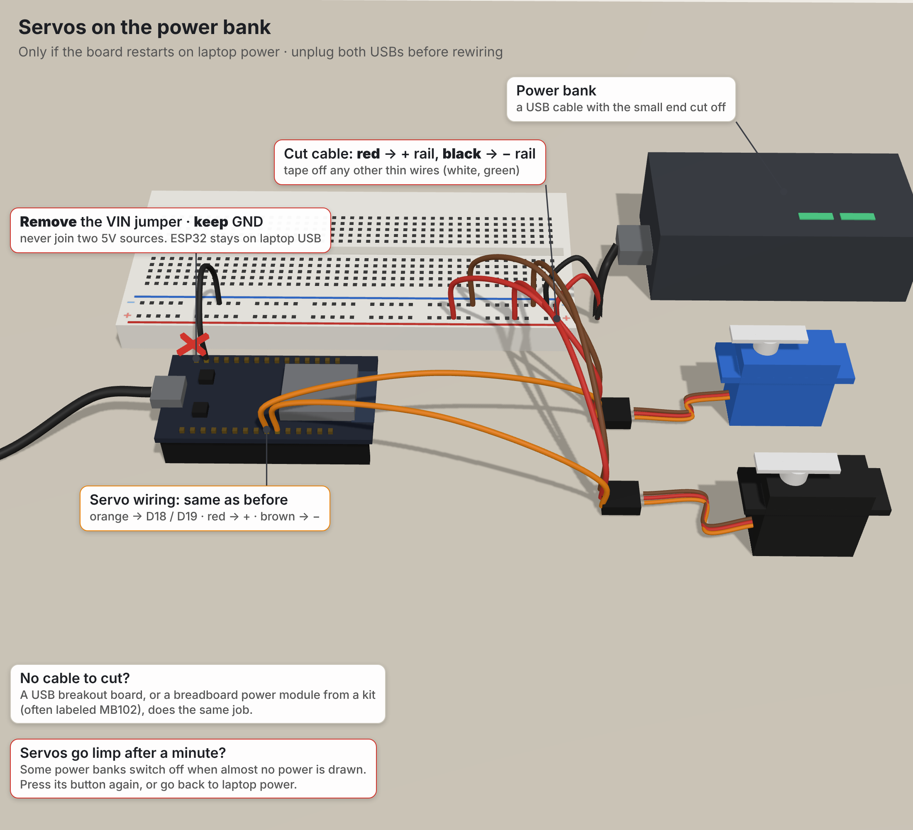
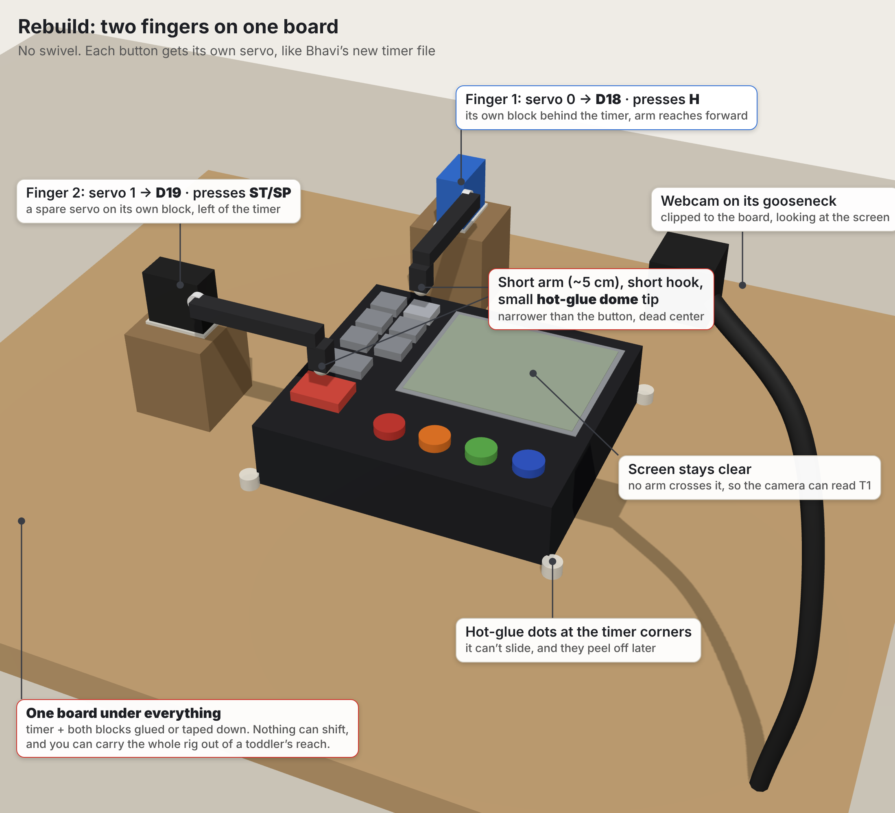

# Hardware: how the AI reaches a real machine

The kitchen timer on our rig has no API: just buttons and a small LCD. This page covers the physical side of Physical MCP:
- how a typed request ends up as a servo pressing a real button
- how the rig is built and wired
- how to calibrate it and hook it to the AI

For running the full app, see the main [README](../README.md) and [`first-loop-checklist.md`](first-loop-checklist.md). Firmware details are in [`firmware/README.md`](../firmware/README.md).

## The chain, from request to button

```
 You type "Set T1 to 2 hours and start it" in the web app
        │  HTTP
        ▼
 backend/api.py ── the step runner (MCP client) ──────────────────────────────┐
        │  calls only MCP tools: get_controls · press · read_screen ·          │
        │  get_frame · stop   (backend/mcp_server.py, approval gate in press)  │
        ▼                                                                      │
 backend/serial_hardware.py                                                    │
        │  looks up the button in backend/devices/timer-01.json                │
        │  (which servo, rest angle, press angle, hold time)                   │
        │  USB serial, 115200 baud, one text line per command                  │
        ▼                                                                      │
 ESP32 firmware (firmware/esp32_finger/esp32_finger.ino)                       │
        │  PWM signal on GPIO 18 / 19                                          │
        ▼                                                                      │
 Servo fingers press H or ST/SP on the timer                                   │
                                                                               │
 USB webcam ── frames ──► vision (SAM 3.1 boxes + Muse Spark screen reads) ◄───┘
                          "did T1 change the way the plan expected?"
```

The AI never writes or changes the firmware. The firmware is a small, fixed program that understands five commands. Everything else lives in software:
- **What to press and when:** the Muse Spark planner.
- **Whether it's allowed:** the approval gate in `press`.
- **Where each button is:** the device profile JSON.

### What one press looks like on the wire

The planner's step says "press H once". The profile says H is servo 0, resting at 90°, pressing at 10°, held for 1000 ms. `serial_hardware.py` sends:

```
CAL 0 90 10          → OK CAL 0 rest=90 press=10
PRESS 0 1 1000       → OK PRESS 0 done=1/1 hold=1000
```

Then the camera reads T1 again. If it went from `00:00 00` to `01:00 00`, the step is verified. If it still shows the old value on two reads in a row, H is pressed again (never for a step that needs approval).

## Firmware commands

| Command | What it does |
|---|---|
| `PING` | Replies `PONG` |
| `ANGLE <servo> <deg>` | Moves one servo and holds it there (0 to 180). Used to find angles |
| `CAL <servo> <rest> <press>` | Sets that servo's rest and press angles until the next reboot |
| `PRESS <servo> <count> [ms]` | Presses `count` times (1 to 30), holding each press `ms` (default 250, 50 to 5000), lifting 350 ms between presses |
| `REST` | Sends every servo to its rest angle. The backend's Stop sends this |

Any new line on serial aborts a running press, even mid-hold, and lifts the finger. On boot the firmware moves every servo to `restAngle` (`{90, 90, 90, 90}`) and prints `READY`. Opening the serial port resets most ESP32 boards, so the fingers go to 90° each time the backend connects. That's why both fingers are built to rest at 90°: a reboot never drives a finger into the timer.

## Parts

| Part | Notes |
|---|---|
| ESP32 dev board | Arduino IDE board "ESP32 Dev Module". Use a data USB cable (charge-only cables are common) |
| 2 micro servos (SG90 / MG90S class) | One per button: H and ST/SP |
| Breadboard + jumper wires | The power rails on long breadboards are often split in the middle |
| Always-on USB power bank | Powers the servos. Some power banks switch themselves off when almost no power is drawn, which looks like a dead servo |
| A USB cable with one end cut off | Red = +5 V, black = ground. Tape off the other thin wires (green, white) one by one |
| USB webcam on a gooseneck clip | Plugs into the laptop, not the microcontroller. The ESP32 can't read a USB webcam |
| 4-channel kitchen timer | The machine with no API (`timer-01`) |
| Finger materials | Short arms, hot glue (tips + mounting), double-sided mounting tape, blocks, one base board |

## Wiring

| From | To |
|---|---|
| H servo, orange (signal) | ESP32 **GPIO 18** = servo 0 |
| ST/SP servo, orange (signal) | ESP32 **GPIO 19** = servo 1 |
| Both servos, red | Breadboard **+** rail |
| Both servos, brown | Breadboard **−** rail |
| Power bank, red | **+** rail |
| Power bank, black | **−** rail |
| ESP32 **GND** | **−** rail (shared ground, required) |
| ESP32 **VIN** | **Not connected** when the power bank is in. Never join two 5 V sources |
| ESP32 USB | Laptop (powers the ESP32 and carries the serial commands) |

Everything has to be on the same half of the rail if the rails are split. Without the shared ground wire, the servos twitch or ignore commands.



## Building the fingers: what worked and why



**One servo per button, no pan.** The first rig used a pan/tilt bracket mounted on a wall. With the pan servo flat against the wall, turning it only spun the finger in a small circle. It couldn't move between buttons. Two fixed fingers are simpler and more reliable.

**Rest at 90°.** Before attaching each arm, run `angle <servo> 90`, then fit the arm level. That way 90 means "resting", and it matches the firmware's boot angle.

**Short arms push harder.** The force at the tip is the servo's torque divided by the arm length. A micro servo makes roughly 1.8 kg·cm at stall, so the numbers below are rough upper bounds:

| Shaft to tip | Push at the tip |
|---|---|
| 6 cm | ~300 g |
| 3 cm | ~600 g |
| 1.5 cm (horn only) | ~1.2 kg |

When a finger "wasn't strong enough", shortening the arm fixed it.

**The tip must be narrower than the button.** A wide, soft eraser landed across H and its neighbour, so the push was split and neither clicked. A small, hard hot-glue dome aimed at the button's center works.

**Push straight down.** At the moment of contact the arm should be roughly level, so the force goes into the button instead of sideways.

**Make it rigid.** Glue the timer and both servo blocks to one base board. A wall mount peeled off under the press force. A shared base also keeps the aim when the rig gets moved, and it can be carried out of reach of small hands.

**Hold for 1 second.** On this timer a 250 ms tap doesn't register, and holding about 2 s makes it auto-repeat. The profile uses `hold_ms: 1000`, and the backend refuses anything over 1800 ms.

## Calibrating a button

1. Quit Arduino IDE (Cmd+Q on a Mac). Only one program can use the serial port.
2. Load the settings into the terminal: `set -a; source .env; set +a`
3. Start at rest, then step one degree at a time toward the button until it clicks:
   ```bash
   .venv/bin/python backend/serial_hardware.py angle 0 90
   .venv/bin/python backend/serial_hardware.py angle 0 89     # keep going until it clicks
   .venv/bin/python backend/serial_hardware.py angle 0 90     # lift it again
   ```
4. Write the angles into `backend/devices/timer-01.json`. Go a few degrees past the click for a firm press. The rebuilt rig (Nov 1):
   ```json
   "btn_h":    { "reachable": true, "servo": 0, "rest_deg": 90, "press_deg": 10, ... },
   "btn_stsp": { "reachable": true, "servo": 1, "rest_deg": 90, "press_deg": 50, ... }
   ```
5. Test it. The bench `press` command doesn't read the profile's hold, so always pass `--hold 1000`:
   ```bash
   .venv/bin/python backend/serial_hardware.py --device timer-01 press btn_h --count 1 --hold 1000
   ```

## Bench checks

```bash
.venv/bin/python backend/serial_hardware.py ping                                          # PONG: the ESP32 is answering
.venv/bin/python backend/serial_hardware.py --device timer-01 press btn_h --count 2 --hold 1000     # T1: 02:00 00
.venv/bin/python backend/serial_hardware.py --device timer-01 press btn_stsp --count 1 --hold 1000  # T1 counts down: 01:59 59
.venv/bin/python backend/serial_hardware.py --device timer-01 frame --out ~/Desktop/timer-rig.jpg
.venv/bin/python backend/serial_hardware.py --device timer-01 read screen_t1             # vision read of T1
```

## Hooking it to the AI

Add the hardware settings to the repo-root `.env`, next to the API keys. Never commit this file.

```
HARDWARE=serial
DEVICE_ID=timer-01
SERIAL_PORT=/dev/cu.usbserial-XXXX
CAMERA_INDEX=0
```

On an Intel Mac, install `cryptography<49` before the requirements (newer versions only ship ready-made for Apple-chip Macs):

```bash
.venv/bin/python -m pip install "cryptography<49"
.venv/bin/python -m pip install -r backend/requirements.txt -r backend/requirements-hardware.txt
```

Then start the backend, the web app and the recorder, as in [`first-loop-checklist.md`](first-loop-checklist.md) section 3. With `HARDWARE=serial`, the backend opens the ESP32 and the webcam. Every press the AI asks for goes:
1. through the MCP `press` tool and its approval gate
2. then through `serial_hardware.py`
3. then to the fingers

Without `HARDWARE=serial`, the same app runs on simulated hardware.

## Reliability so far

| Test | Result |
|---|---|
| H, first rig, 20 presses through Python, 1 s hold (Oct 30) | 20 / 20 |
| Rebuilt rig, H and ST/SP | TODO: measure |

## Troubleshooting: things that actually happened

| You see | Cause and fix |
|---|---|
| `Resource busy` opening the port | Arduino IDE (or another script) holds the port. Quit it with Cmd+Q |
| `READY` printed mid-press, or the board resets | Brownout. Power the servos from the power bank, with the ground shared |
| Servos go limp after about a minute | The power bank switched itself off at low draw. Use an always-on bank |
| One servo never moves but replies `OK ANGLE` | Signal or power isn't reaching it. Check the pin label (GPIO 18 / 19), re-seat the jumper, and check the servo's red and brown are on the powered half of a split rail |
| The finger moves but the button doesn't click | Check four things: a tip landing between two buttons, an arm too long, the mount flexing, a 250 ms tap (pass `--hold 1000`) |
| The number jumps by 2 or more per press | The hold is too long and the timer auto-repeats. Keep the hold under 1.8 s |
| The script opened the Inkbird profile | Pass `--device timer-01`, or set `DEVICE_ID=timer-01` and source `.env` |
| `pip` fails building `cryptography` (Intel Mac) | `pip install "cryptography<49"` first |
| The webcam frame shows your face | Wrong camera. Set `CAMERA_INDEX=1` in `.env` |

## Safety

- **Stop** sends `REST`. The firmware aborts mid-hold and lifts the finger at once.
- ST/SP starts the countdown, so it always needs a press-and-hold approval in the app.
- The backend caps each job at 30 presses and each hold at 1.8 s.
- Never connect the ESP32's VIN and the power bank to the same rail. Keep the bare red and black power wires taped and apart.
